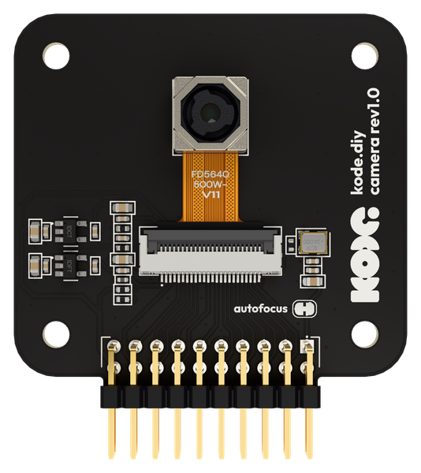

<div align="center" markdown="1">



# kode-camera-sdk

**The SDK for the Camera module of the Kode Dot: live frames, photos up to 5 megapixels, autofocus and video with sound, from an app, in C**

[](https://github.com/espressif/esp-idf)


[Documentation](https://docs.kode.diy/modules/camera) ·
[Quick start](#quick-start) ·
[Examples](#examples) ·
[The SDK in depth](docs/guide.md) ·
[kode-sdk](https://github.com/kodediy/kode-sdk)

</div>

---

The Camera module (KDCMR001) plugs into the expansion header J3 of the **Kode Dot**, either way up. It carries an OmniVision OV5640 on an 8-bit DVP bus, a lens on a motor that the sensor drives, and its own 24 MHz oscillator. This SDK sits next to [kode-sdk](https://github.com/kodediy/kode-sdk): an app adds one more dependency and takes frames, photos and movies without knowing the pins, the sensor's registers or which way round the module is.

- **One owner.** The module belongs to one Active Object, `AO_Camera`. It finds the camera, brings it up, watches it and runs the autofocus; your code asks it and never touches the sensor.
- **Two layers, as in kode-sdk.** `camera.h` has calls that wait, for `app_main()` and your tasks; `camera_sys.h` has calls that never wait, for an Active Object of your own.
- **Nothing to set up.** It finds the module on J3 either way up, focuses on its own, and turns every frame, photo and movie upright.

```c
#include "camera.h"
#include "kode.h"

KODE_APP_MANIFEST("My camera app", "example");

void app_main(void)
{
    kode_init();                                    /* start the board */
    camera_begin();                                 /* look for the camera on J3 */
    if (camera_wait_present(3000)) {                /* waits for the first frames */
        camera_photo_save("/sdcard/photo.jpg", 90); /* 800 x 600, upright */
    }
    camera_end();
    kode_exit();                                    /* back to kodeOS */
}
```

## Quick start

You need a Kode Dot running kodeOS, a Camera module, a microSD card and [ESP-IDF v6.1](https://docs.espressif.com/projects/esp-idf/en/v6.1/esp32p4/get-started/). Plug the module into J3 with the Dot off.

```bash
. <path-to-esp-idf>/export.sh
idf.py -C examples/module build
idf.py -C examples/module -p PORT flash
```

`flash` writes the app to the board's mailbox; kodeOS installs it and starts it. The log says where the camera was found, which way round, and its frame rate. Hold the bottom button to go back to kodeOS.

The first build of a project fetches kode-sdk and the board's settings, and configures twice; it may print one CMake error along the way; the build carries on.

## Examples

| | |
|---|---|
| [`module`](examples/module) | the camera found on J3, its status, and its events (task layer) |
| [`settings`](examples/settings) | every setting, and one photo of each look (task layer) |
| [`photo`](examples/photo) | 800 x 600 and 5 MP photos to the microSD (Active Object layer) |
| [`viewer`](examples/viewer) | the camera on the whole screen with LVGL, touch to focus (Active Object layer) |
| [`video`](examples/video) | thirty seconds of video with sound (Active Object layer) |
| [`console_actions`](examples/console_actions) | the camera on kodeOS's console (Active Object layer) |

None of them records or takes a photo by itself: each waits for a button press, a touch or a console command.

## Use it in your project

```yaml
# main/idf_component.yml
dependencies:
  kodediy/kode:
    git: https://github.com/kodediy/kode-sdk.git
    path: components/kode
    version: v0.1.5
  kodediy/camera:                                   # or kodediy/camera_sys, for the Active Object layer
    git: https://github.com/kodediy/kode-camera-sdk.git
    path: components/camera                         # or components/camera_sys
    version: v0.1.0
```

Add `camera` (or `camera_sys`) to your component's `REQUIRES`. The rest of the SDK arrives at the same release through the layer's own manifest. Your `sdkconfig.defaults` sets `CONFIG_KODEOS_RADIO=y`, because the Dot's C5 switches J3's supply and the microSD's, and these five lines, which choose the OV5640's format table the SDK starts from:

```
CONFIG_CAMERA_OV5640=y
CONFIG_CAMERA_OV5640_AUTO_DETECT_DVP_INTERFACE_SENSOR=y
CONFIG_CAMERA_OV5640_DVP_RGB565_800X600_10FPS=y
CONFIG_CAMERA_OV5640_DVP_RGB565_BE_800X600_10FPS=y
CONFIG_CAMERA_OV5640_DVP_DEFAULT_FMT_RGB565_BE_800X600_10FPS=y
```

Copy `CMakeLists.txt` and `sdkconfig.defaults` from an example: they fetch the Dot's settings from kode-sdk rather than repeating them.

## What has run on a module

The SDK runs today inside Kode's Camera, Webcam and Identify apps, on Kode Dots with kodeOS 0.1.5 and kode-sdk v0.1.5: photos at 5, 2 and 0.5 MP, movies with sound at the sensor's 14.3 frames a second, the viewfinder fitted by the P4's PPA, exposure, zoom, the gallery and playback. The `module`, `photo` and `settings` examples have run on a module too.

## Not run on a module yet

The `viewer`, `video` and `console_actions` examples, a v1.1 module and the sound's offset against the picture (`audio_delay_ms` is 0; the clap test of `examples/video` finds it) have not run on a module with this version. A power cut in the middle of a movie or a photo is covered by the host tests only, and loading the sensor's own focus firmware (optional, not shipped here) has not run on a module.

## Documentation

The module, its pins and how to plug it in are at **[docs.kode.diy/modules/camera](https://docs.kode.diy/modules/camera)**. The calls are documented in their headers, [`camera.h`](components/camera/include/camera.h) and [`camera_sys.h`](components/camera_sys/include/camera_sys.h). [The SDK in depth](docs/guide.md) covers the two modes of the sensor, the focus, photos, video, the 23 settings, how the owner works and what an app pays for the camera. Each component also has a short README.

## Contributing

Bugs, ideas and pull requests are welcome: open an issue or a pull request. Read [CONTRIBUTING.md](https://github.com/kodediy/.github/blob/main/CONTRIBUTING.md) first. A change goes to `main` only through a pull request that the SDK's maintainer has approved, and a release is a tag on `main`. The checks a change must pass, run on your machine:

```bash
tools/host_tests.sh                    # the seven host suites; --sanitize for ASan and UBSan
tools/check_layers.sh
tools/check_example_pins.sh
idf.py -C tests/target build
tools/check_ram.sh tests/target/build tests/target/ram_budget.txt
```

## Licence

[GPL-3.0-or-later](LICENSE), like kode-sdk. The OV5640's own autofocus firmware is not in this repository and keeps its own licence; [NOTICE.md](NOTICE.md) says which applies where.
